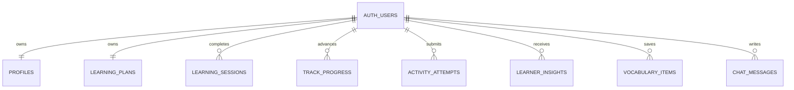

# FALA English — Database Architecture

## Production project

- Supabase project: `fala-english`
- Project reference: `vmrcjfbyvmrstlgpihfz`
- Region: `sa-east-1` (São Paulo)
- PostgreSQL: 17
- Application URL: `https://alefsoaresvp-sudo.github.io/FALA/`

Use this project only for FALA. Do not combine another independent product's customer data with these tables.

## Logical modules

The current schema stays in the exposed `public` schema because the React client uses Supabase Data API and the existing RLS policies. The modules below are logical boundaries, not separate PostgreSQL schemas.

| Module | Table | Responsibility | Primary relationship |
|---|---|---|---|
| Identity | `profiles` | Learner preferences, goals, interests, barriers and feedback style | 1:1 with `auth.users` |
| Planning | `learning_plans` | Current adaptive plan returned by Lumi | 1:1 with `auth.users` |
| Learning history | `learning_sessions` | Append-only record of completed practice sessions | Many:1 with `auth.users` |
| Learning paths | `track_progress` | Progress by learner and learning track; exam score and pass state | Many:1 with `auth.users` |
| Assessment | `activity_attempts` | Prompt, learner answer, correction and score | Many:1 with `auth.users` |
| Adaptation | `learner_insights` | Evidence-backed observations and recommendations | Many:1 with `auth.users` |
| Personal content | `vocabulary_items` | Saved terms, meanings, examples and review schedule | Many:1 with `auth.users`; unique term per learner |
| Conversation | `chat_messages` | User and Lumi messages plus compact correction metadata | Many:1 with `auth.users` |

## Entity relationship map

## Ownership and access control

- Every learner-owned table has a `user_id` foreign key to `auth.users(id)`.
- RLS is enabled on all eight tables in `public`.
- Authenticated policies compare `user_id` with `(select auth.uid())`; grants do not replace row-level checks.
- The browser uses only the Supabase publishable key. Do not add a service-role key, secret key or OpenAI key to `VITE_*`, GitHub Pages assets, or the client bundle.
- The two Edge Functions, `tutor` and `transcribe`, require a valid user JWT.

## Data lifecycle

- Audio is processed in memory by the transcription Edge Function. The raw recording is not written to Supabase Storage or PostgreSQL.
- Only the recognized text and minimal session metadata are stored, when the user is authenticated.
- Chat and assessment content are retained in their respective learner-owned tables. Any future delete/export feature should cover all of those tables.
- AI observations are hypotheses about learning performance and should be backed by an attempt/session, not treated as permanent labels.

## Reusing this model in another product

### Recommended: separate Supabase project

For another independent system, create another Supabase project and adapt this schema there. That gives the new system separate Auth users, API keys, backups, RLS policies, secrets, usage limits and data lifecycle. It also prevents accidental joins or exposure between products.

### If multiple apps must share one database

Do not copy the current policies unchanged. First introduce an explicit application/workspace boundary such as `app_id` or `workspace_id` on every tenant-owned row, define who may access that boundary, and include it in all RLS predicates, indexes, foreign keys and unique constraints. Test cross-tenant reads and writes before production. A `TO authenticated` policy without a tenant predicate is not sufficient.

## Deployment and changes

- `schema.sql` is the clean, repeatable baseline for a new FALA-compatible database.
- Apply additive production changes through reviewed Supabase migrations. Avoid destructive renames or dropping data as part of UI work.
- The baseline includes RLS, grants, owner policies, useful lookup indexes and timestamp triggers.
- After a schema change, inspect the tables, run the Supabase Security Advisor, and test access using two different authenticated users.

## Secrets and runtime configuration

Supabase Edge Function secrets (server only):
- `OPENAI_API_KEY`
- Optional `OPENAI_MODEL`

GitHub Actions build variables (public values only):
- `VITE_SUPABASE_URL`
- `VITE_SUPABASE_PUBLISHABLE_KEY`

Never commit secret values. Rotate any key that has been pasted into chat, source code, screenshots or browser-visible configuration.
